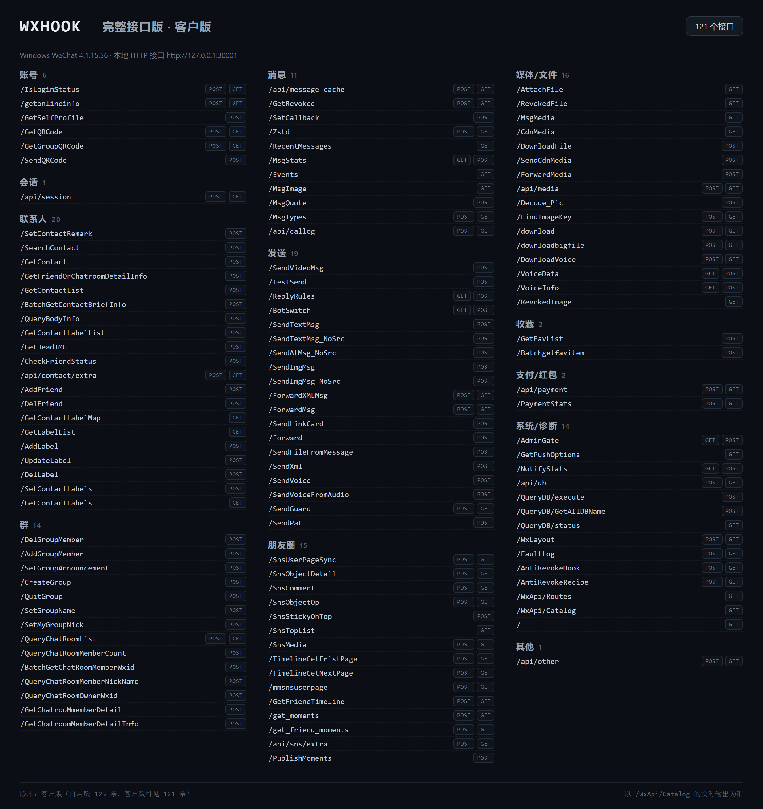
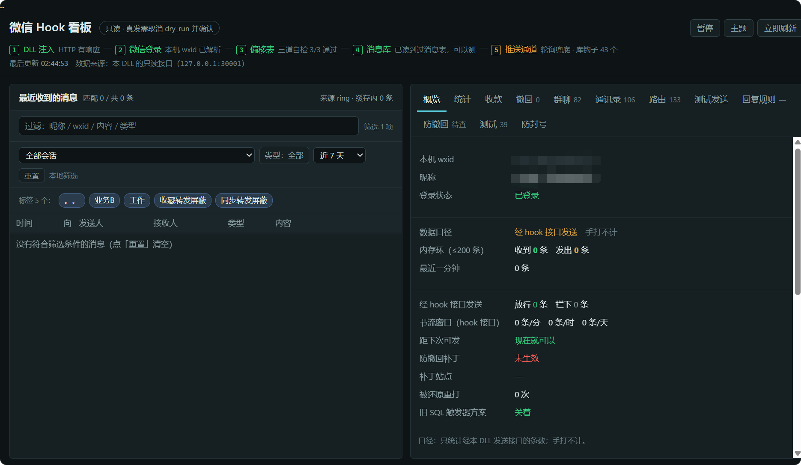

# fgwx

<div align="center">
    <h3>🚀 基于 WeChat PC Hook 的高级微信管理工具 🚀</h3>
    <p align="center">
        
        
        
        
    </p>
    <p align="center">
        <b>⭐️ 欢迎加入官方交流群 ⭐️</b><br>
        👉 <a href="https://t.me/+j3eyMzbbnMdlMmQ1">Telegram 群组</a>
    </p>
</div>

<div align="center">

[🎯 三十秒看懂](#-三十秒看懂) •
[⚡ 快速开始](#-快速开始) •
[📝 功能特性](#-功能特性) •
[🔌 接口调用](#-接口调用) •
[⚠️ 使用须知](#️-使用须知) •
[🧯 排障](#-常见问题)

</div>

---

## 🎯 三十秒看懂

**你只需要一个文件：`fgwx.exe`。**

它做三件事：

```
双击 fgwx.exe
   ├─ 弹出登录窗口 → 输入账号密码
   ├─ 自动给当前登录的微信装上功能
   └─ 校验通过 → 提示"可以关闭本窗口"
之后：
   你的程序 ←HTTP→ 127.0.0.1:30001 ←→ 微信
```

- **开箱即用**：单个 exe，无外部依赖，不需要额外部署任何服务
- **不需要** 修改微信本体的任何文件，卸载就是删目录
- 登录窗口关掉**不影响使用**；微信重启后需要再双击一次

> 适用微信 PC 版：**4.1.15.56**（4.1.15.53 也兼容，其他版本一定失败）

---

## ⚡ 快速开始

### 1. 核对微信版本（不看这步，后面全是白费）

微信 → 左下角 **三条横线** → **设置** → **关于微信**，版本号必须是 `4.1.15.56`。
高了降级、低了升级，必须对齐；差一个补丁号微信会直接崩溃。

### 2. 先登录微信，再运行程序

`fgwx.exe` 是给**已经登录的微信**装功能的，不是登录微信用的。
顺序反了会提示"没找到微信登录"。

### 3. 放到固定目录并加白

建议放 `D:\fgwx\`，别放桌面或下载夹。这类程序 100% 会被杀软拦截：

1. 把 `fgwx.exe` 所在目录加入杀软**信任区/白名单**
2. 被直接删了就从压缩包重新解压一份，再把它加白

部分机器（微信装在 `C:\Program Files`）需要：

> 右键 `fgwx.exe` → **以管理员身份运行**

### 4. 登录并验证

双击 `fgwx.exe` → 填账号密码 → 等进度跑完。成功的标志：

```
验证通过，可以开始使用。
本窗口现在可以关闭（关掉不影响使用）。
```

然后浏览器打开下面的地址确认通了：

```
http://127.0.0.1:30001/getonlineinfo
```

```json
{"status":0,"data":{"isLogin":true,"self_wxid":"wxid_你的号"}}
```

### 5. 调用你的第一个接口

```bash
curl -X POST http://127.0.0.1:30001/SendTextMsg ^
  -H "Content-Type: application/json" ^
  -d "{\"wxidorgid\":\"filehelper\",\"msg\":\"hello fgwx\"}"
```

```python
import requests

r = requests.post("http://127.0.0.1:30001/SendTextMsg", json={
    "wxidorgid": "filehelper",
    "msg": "hello fgwx",
})
print(r.json())          # {"ret":0,"retmsg":"..."}
```

---

## 📝 功能特性

fgwx 通过 Hook 微信 PC 客户端，把**本地数据库 + 原生协议 CGI** 封装成一套统一的 HTTP 接口，客户版可见 **121 条**。

<div align="center">
    
    <p><sub>完整接口总览（121 条，12 个分组）。实时清单以 <code>http://127.0.0.1:30001/WxApi/Catalog</code> 为准</sub></p>
</div>

### 账号（6 条）

- 登录状态、本机 wxid、个人信息
- 本人二维码 / 群二维码（原生 CGI 168，返回官方 `wxp://` 链接）
- 发送二维码（`kind=self|group`）

### 联系人（20 条）

- 通讯录分页（`all / chatroom / non_chatroom / friend`）、批量简报、关键词检索
- 联系人/群详情（群带群主、成员数、群公告）
- 改备注（`/SetContactRemarkNative2`）、星标 / 好友免打扰（`/SetContactFlag`）
- 加好友（verifyuser）、删好友（oplog CmdId=4）
- 标签全链路：新建 / 重命名 / 删除 / 打标签 / 标签↔联系人映射

### 群（14 条）

- 群列表、成员数量、成员 wxid 列表、群昵称、群主、成员详情
- 建群、退群、改群名、设置我在本群昵称
- 拉人进群、踢群成员、改群公告（**危险接口，默认关闭**）
- 群免打扰（`/SetGroupMute`）

### 消息（10 条）

- 内存环消息缓存、最近消息、消息统计与筛选、SSE 事件流
- 防撤回：被撤回消息的原文 / 图片 / 文件
- 消息类型分类器、引用消息解析（`refermsg`）、通话记录
- 任意只读 SQL 直查微信活连接（`/QueryDB/execute`）

### 发送（19 条）

- 文本 / @所有人、图片、视频、语音（含 WAV → SILK）、链接卡片、拍一拍
- 统一转发 `/ForwardBatch`（文本 / 名片 / 图片 / 视频 / 文件自动分派）
- 发送治理层 `SendGuard`：节流 / 配额 / 静默时段
- 每会话机器人开关 `BotSwitch`、回复规则 `ReplyRules`

### 朋友圈（15 条）

- 拉好友相册（联网 CGI 212）、单条详情（评论 + 点赞 + 计数）
- 点赞 / 评论 / 回复、取消赞 / 删评论 / 删除自己的动态
- 发布（纯文案 + **带图**，两步：先 `SnsMediaUpload` 拿 `media_xml` 再发帖）
- 置顶 / 取消置顶、我的置顶分页、媒体下载与解密

### 媒体 / 文件（16 条）

- `/MsgMedia`：按消息取原图 / 中图 / 缩略图 / 视频 / 文件，直接回字节
- `/CdnMedia`：按 `fileid + aeskey` 直取，不需要本地缓存
- 落盘下载、CDN 资产直发（`/SendCdnMedia`）、附件直出
- 本地 `.dat` 图片解密、账号级图片密钥检索

### 其他

- 收藏（2 条）、支付/转账/红包/收款统计（2 条）
- 系统诊断：`/WxApi/Catalog` 接口目录、`/WxLayout` 偏移自检、`/QueryDB/status` 采集状态、`/FaultLog` 故障地址记录

### 内置只读看板

浏览器打开 `http://127.0.0.1:30001/`，登录链路、推送通道、消息环、防撤回补丁、发送治理一屏看全：

<div align="center">
    
</div>

---

## 🔌 接口调用

### 连接

```
http://127.0.0.1:30001
```

只监听本机回环，**外网/局域网连不上**，这是有意的设计。除少数 GET 专用接口外，POST 与 GET 都接受，参数可放 JSON body 或 query。

### 响应形状（有三种，判据不要一刀切）

| 形状 | 出现在 | 例子 |
|---|---|---|
| `{"ret":0,"retmsg":"…", …}` | 发送类 | `/SendTextMsg` |
| `{"status":0,"desc":"…","data":{…}}` | 大多数读接口 | `/GetContact`、`/RecentMessages` |
| 扁平（无信封） | `/MsgStats`、`/QueryDB/status` | `/MsgStats` |

### 状态码

| ret / status | 含义 |
|---|---|
| `0` | 请求已提交 / 读取成功 |
| `-1` | 参数错误（看 `desc` / `retmsg`） |
| `8` | 前置条件不满足（未登录 / 未通过自证 / 危险接口缺开关） |
| `9` | 被发送治理层拦截（节流 / 配额 / 静默时段） |
| `-9` | 内部异常（已被捕获，不会带走微信） |
| `403` | **未授权**（没登录 / 到期 / 换了微信号） |

> ⚠️ **`ret=0` 不等于"对方收到了"**。判成败请看数据库 `status` 列，见下文。

### 判据：发送是否成功只看 `status` 列

| `status` | 含义 |
|---|---|
| `2` | 本机发出且服务端已回执（**唯一成功判据**） |
| `5` | 发送失败 / 服务端零回执（界面上是红叹号） |
| `3` | 收到（对方发的） |
| `1` | 刚写入、还在上传（3 秒内看到 1 别急着判失败） |

- `sendRawRet` **没有判别力**：成功与失败都是 `1`
- `ret=0` / `status=0` 只代表"请求已提交"，不代表送达

### 推送到你的服务

```bash
# 设置回调
curl -X POST http://127.0.0.1:30001/SetCallback -d "{\"url\":\"http://127.0.0.1:8080/fgwx\"}"

# 或订阅 SSE 事件流
curl -N http://127.0.0.1:30001/Events
```

回调全失败时所有接口也会回 200，请用 `GET /QueryDB/status` 看 `updateHook.postCalls` 与 `lastSkip` 排查。

### 危险接口需要两步

群公告 / 踢人 / 拉人 / 改备注 / 建群 / 退群等默认**运行期关闭**：

```bash
# 1) 先开运行期开关（token 在 %LOCALAPPDATA%\WeixinHook\hook_startup.log）
curl -X POST http://127.0.0.1:30001/AdminGate -d "{\"op\":\"enable\",\"token\":\"<token>\"}"

# 2) 再调用，并带危险开关（参数名是 room + wxids 数组，不是 chat_id / member_wxid）
curl -X POST http://127.0.0.1:30001/DelGroupMember -d "{
  \"room\":\"xxx@chatroom\",\"wxids\":[\"wxid_yyy\"],
  \"allow_risky_submit\":1,\"i_know_it_is_irreversible\":1,\"confirm\":1
}"
```

未开启时返回：

```json
{"gate":"disabled","ok":false,"ret":8,"retmsg":"该接口未开启（运行期开关默认关闭）…"}
```

写操作普遍遵循 `dry_run` 先回显、`confirm=1` 才真发的约定，**新接入请先 `dry_run` 跑一遍**。

---

## ⚠️ 使用须知

### 授权规则

**一个账号绑一个微信**，第一次校验通过时绑定到当前登录的微信号：

| 情况 | 结果 |
|---|---|
| 同一个微信号，换电脑 / 重装系统 | ✅ 可以，重新登录一次即可 |
| 换一个微信号 | ❌ 不行，授权绑在原来的号上 |
| 一个账号同时挂两个微信号 | ❌ 不行 |

到期后功能自动停服、接口返回 403，续费后再跑一次 `fgwx.exe` 即恢复。

**未授权时只有 `/getonlineinfo` 可访问**，其余全部返回：

```json
{"status":403,"desc":"未授权：请运行 fgwx.exe 登录（登录后本程序会自动生效）","licensed":false}
```

看到 403 不要怀疑程序坏了，是**没登录 / 密码失效 / 到期 / 换了微信号**其中之一。

### 什么时候需要重开 `fgwx.exe`

| 场景 | 要不要重开 |
|---|---|
| 关掉登录窗口继续用 | 不需要 |
| 用了一整天 | 不需要（功能自己续期） |
| 微信重启 / 电脑重启 | **需要** |
| 微信升级过 | **需要**，且要先核对版本号 |
| 换微信号登录 / 续费 / 改密码 | **需要** |

### 关于风控

**忠告：切记莫贪，新号尽量稳定挂机 3 天后再使用危险性高的接口操作。**

- 新号登录后 24 小时内可能掉线一次，重新登录即可（**用原来的 API key，不要换新的**，换 key 等于换设备）
- 一个授权 key 只能给一个微信使用，多个号请生成多个 key
- 发送类接口建议开启 `SendGuard` 节流，群发时拉开间隔
- 高危险接口（踢人 / 拉人 / 改备注 / 建群）先在 `dry_run` 下自检，确认无误再 `confirm`

---

## 🧯 常见问题

### 浏览器打不开 `127.0.0.1:30001`

| 检查项 | 做法 |
|---|---|
| 微信是不是开着 | 任务管理器里要有 `Weixin.exe` |
| 微信是不是登录了 | 微信要停在**已登录**的主界面 |
| `fgwx.exe` 跑过没有 | 微信重启后必须重新跑一次 |
| 是不是被杀了 | 看任务管理器有没有 `fgwx.exe` 残留，杀掉重跑 |
| 杀软删了文件 | 白名单 + 重新解压 |

### 所有接口都返回 403

1. 有没有在 `fgwx.exe` 里成功登录过一次？
2. 当前微信是不是**绑定时的那个微信号**？
3. 账号是不是到期了？
4. 进 `%LOCALAPPDATA%\WeixinHook\` 看有没有 `hook.on`：没有 → 校验没走完；有 → 服务端不认（到期/被顶号），重新登录

### 微信改版本 / 自动升级后功能异常

`fgwx.exe` 报"微信版本不支持"就是版本号不匹配。先彻底退出微信（杀光所有 `Weixin.exe`），对齐版本后再跑一次。

### 微信卡顿 / 崩溃

1. 彻底退出微信后重开
2. 确认微信版本没变过
3. 还不行就把 `%LOCALAPPDATA%\WeixinHook\injector_ui.log` 发给我们

### 发送返回 0 但对方没收到

看目标会话表 `Msg_<md5>` 的新行 `status` 是否为 `2`。`ret=0` 只代表请求已提交。

### 微信重启后 10~20 秒内 DB 接口报错

数据库句柄还没就绪，属正常现象，重试即可，不要死等。

---

## 🛠 停止与卸载

### 只想让功能停下来（不卸载）

1. 删除 `%LOCALAPPDATA%\WeixinHook\hook.on`
2. 重启微信

之后功能还在，但接口全部 403。想恢复：重新跑 `fgwx.exe` 登录。

### 彻底卸载

1. 彻底退出微信（任务管理器杀光 `Weixin.exe`）
2. 删掉 `fgwx.exe`
3. 删掉整个 `%LOCALAPPDATA%\WeixinHook\` 目录
4. 重开微信 —— 就是干净的微信了

微信本体没有任何文件被改动，也没有卸载残留。

### 升级到新版本

```
① 任务管理器杀光所有 Weixin.exe
② 用新的 fgwx.exe 覆盖旧的
③ 启动微信、登录
④ 双击 fgwx.exe 重新验证一次
```

**不需要手动替换任何文件**，程序自己处理。

---

## 📂 文件与路径速查

| 东西 | 位置 |
|---|---|
| 程序本身 | 你放的目录，如 `D:\fgwx\fgwx.exe` |
| 登录凭据（DPAPI 加密） | `%LOCALAPPDATA%\WeixinHook\login.dat` |
| 授权标记 | `%LOCALAPPDATA%\WeixinHook\hook.on` |
| 危险接口开关 token | `%LOCALAPPDATA%\WeixinHook\hook_startup.log` |
| 程序运行时文件 | `%LOCALAPPDATA%\WeixinHook\payload\`（自动管理，**不要手动改动**） |
| 临时目录 | `%LOCALAPPDATA%\WeixinHook\tmp` |
| 日志 | `%LOCALAPPDATA%\WeixinHook\injector_ui.log` |
| 本地接口 | `http://127.0.0.1:30001` |
| 只读看板 | `http://127.0.0.1:30001/` |

> `%LOCALAPPDATA%` 一般就是 `C:\Users\你的用户名\AppData\Local`，直接在资源管理器地址栏粘贴 `%LOCALAPPDATA%\WeixinHook` 就能打开。

---

## 📚 文档索引

| 文档 | 内容 |
|---|---|
| [fgwx使用说明.md](./fgwx使用说明.md) | 只讲怎么把一个 `fgwx.exe` 用起来（安装、授权、排障、卸载） |
| [接口清单-完整版.md](./接口清单-完整版.md) | 121 条客户版接口的详细参数、响应样例、判据与限制清单 |
| `http://127.0.0.1:30001/WxApi/Catalog` | 运行时的机器可读接口目录（永远和当前版本一致） |
| [static/img/api-overview.png](./static/img/api-overview.png) | 接口总览图（121 条，12 个分组，由 `tools/gen_api_overview.py` 生成） |
| `static/img/web-panel.png` | 看板界面截图 |

> 接口总览图是从 `接口清单-完整版.md` 的分组数据生成的，接口有增减时执行 `python tools/gen_api_overview.py` 重新出图即可（HTML → Chrome 无头截图 → 裁剪），图片统一放在 `static/img/`。

---

> 本项目仅用于个人微信增强与自动化研究，请遵守微信用户协议与当地法律法规。因违规使用导致的封号、数据丢失等后果由使用者自行承担。
